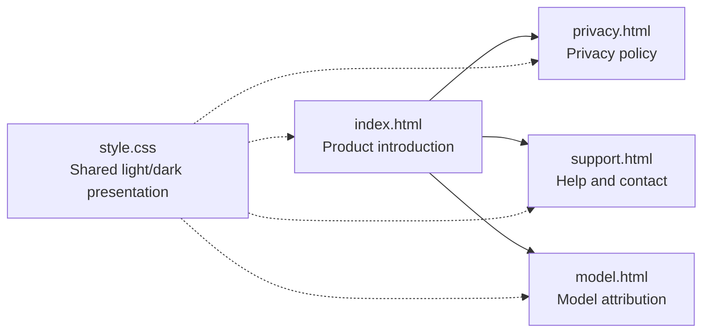

# SetFlow — Product Documentation Site

A small **static HTML and CSS website** that gives SetFlow users a clear place
to read the privacy policy, find support and inspect third-party model credits.
Its shared navigation, readable typography and light/dark styling keep the
supporting documentation consistent across pages.

[Home source](index.html) · [Privacy policy](privacy.html) · [Support](support.html) · [Shared stylesheet](style.css)

## Page map

*Repository navigation diagram, not an application screenshot. Links above open
the page source in GitHub.*

## Skills demonstrated

| Skill | Where it appears |
| --- | --- |
| **Semantic HTML5 and document structure** | Language metadata, headings, navigation, main content and footer elements in [index.html](index.html) |
| **CSS, responsive layout and readable typography** | Fluid content width, viewport metadata and shared spacing/type rules in [style.css](style.css) and the HTML pages |
| **Light/dark theme support** | CSS custom properties and `prefers-color-scheme` in [style.css](style.css) |
| **Technical writing and product documentation** | Task-focused help in [support.html](support.html) and product data-handling explanations in [privacy.html](privacy.html) |
| **Static-site organization** | Direct HTML pages with a shared stylesheet and a [`.nojekyll`](.nojekyll) marker for GitHub Pages hosting |

## View and maintain

The repository uses plain HTML/CSS without a build step. Open `index.html`
locally to inspect the site, or use a local static server when testing changes.
The privacy, support and attribution pages share the same stylesheet.

The native iPhone app remains in development. For product workflows, dated
interface examples and engineering discussion, see the separate
[SetFlow product case study](https://github.com/vanshverma0401-wq/setflow-product-case-study).
This documentation repository contains the supporting website, rather than the
native application source.

## Support and attribution

Contact: [appsetflow@gmail.com](mailto:appsetflow@gmail.com).

The [model attribution page](model.html) and [full licence notice](model/LICENSE-NOTICE.md)
retain the third-party credits and reuse terms. Those terms are separate from
the app's own code.
